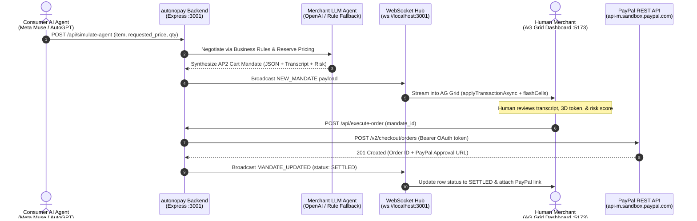

# autonopay | Autonomous Agent-to-Agent (A2A) Commerce Gateway
### Comprehensive Technical Architecture & Project Reference

---

## 📑 Table of Contents
1. [Executive Summary & Purpose](#1-executive-summary--purpose)
2. [High-Level Architecture & Data Flow](#2-high-level-architecture--data-flow)
3. [The Core Protocol: AP2 Cart Mandates](#3-the-core-protocol-ap2-cart-mandates)
4. [Backend Deep Dive (`/backend`)](#4-backend-deep-dive-backend)
   - [Server Entrypoint (`src/index.ts`)](#server-entrypoint-srcindexts)
   - [Merchant Agent Negotiation Engine (`src/services/merchantAgent.ts`)](#merchant-agent-negotiation-engine-srcservicesmerchantagentts)
   - [PayPal Settlement Service (`src/services/paypalService.ts`)](#paypal-settlement-service-srcservicespaypalservicets)
   - [WebSocket Broadcast Hub (`src/services/websocketServer.ts`)](#websocket-broadcast-hub-srcserviceswebsocketserverts)
   - [Data Models & Types (`src/types/mandate.ts`)](#data-models--types-srctypesmandatets)
5. [Frontend Deep Dive (`/frontend`)](#5-frontend-deep-dive-frontend)
   - [Application Shell & State Sync (`src/App.tsx`)](#application-shell--state-sync-srcapptsx)
   - [Clearance Grid Engine (`src/components/ClearanceGrid.tsx`)](#clearance-grid-engine-srccomponentsclearancegridtsx)
   - [Interactive 3D WebGL Badge (`src/components/ThreeSecurityBadge.tsx`)](#interactive-3d-webgl-badge-srccomponentsthreesecuritybadgetsx)
   - [In-Grid 3D Polyhedral Token (`src/components/ThreeTokenCellRenderer.tsx`)](#in-grid-3d-polyhedral-token-srccomponentsthreetokencellrenderertsx)
   - [Integrated Slide-Over Deck (`src/components/GridSidebarDeck.tsx`)](#integrated-slide-over-deck-srccomponentsgridsidebardecktsx)
   - [KPI Command Header & Controls (`src/components/TopHeader.tsx`)](#kpi-command-header--controls-srccomponentstopheadertsx)
   - [Inbound Simulation Modal (`src/components/SimulateModal.tsx`)](#inbound-simulation-modal-srccomponentssimulatemodaltsx)
   - [Custom Cell Renderers & Micro-Components](#custom-cell-renderers--micro-components)
6. [API & WebSocket Specification](#6-api--websocket-specification)
   - [REST Endpoints](#rest-endpoints)
   - [WebSocket Message Protocol](#websocket-message-protocol)
7. [PayPal Orders REST API Integration](#7-paypal-orders-rest-api-integration)
8. [Configuration & Environment Variables](#8-configuration--environment-variables)
9. [Setup, Execution & Verification Guide](#9-setup-execution--verification-guide)
10. [Troubleshooting & FAQ](#10-troubleshooting--faq)

---

## 1. Executive Summary & Purpose

**autonopay** is an **Agent-to-Agent (A2A) Commerce Gateway and Financial Command Center**. It bridges the **"Trust Gap"** in autonomous AI commerce by acting as an intelligent, secure B2B receiving agent.

### The Problem
As autonomous AI agents (such as procurement bots, coding agents, or personal assistants like Meta Muse and AutoGPT) become capable of sourcing goods, compute resources, API credits, and cryptographic assets, they need a safe, verifiable mechanism to negotiate deals and execute real-world payments without exposing corporate bank accounts or raw credentials to unverified endpoints.

### The autonopay Solution
1. **Autonomous B2B Negotiation**: An incoming consumer agent connects to autonopay's merchant agent. The merchant agent applies programmatic business rules (reserve pricing, volume discounts, quota policies, and risk profiling) using either an LLM (OpenAI GPT-4o-mini) or rule-based deterministic mock agents.
2. **AP2 Cart Mandate Synthesis**: Once agreement is reached, the transaction is cryptographically structured into a strict **AP2 Cart Mandate**.
3. **Live WebSocket Telemetry**: The mandate is broadcast over WebSockets to an AG Grid financial terminal dashboard in sub-millisecond time.
4. **Human-in-the-Loop (HITL) Clearance**: High-value or high-risk transactions are visually flagged with real-time risk scoring, 3D cryptographic security tokens, and conversational chat transcripts for human clearance.
5. **Automated PayPal Settlement**: Clicking **"Approve"** initializes the **PayPal Orders API (`/v2/checkout/orders`)**, converts the mandate items into official PayPal `purchase_units`, generates a verified checkout URL, and marks the mandate as `SETTLED`.

---

## 2. High-Level Architecture & Data Flow



---

## 3. The Core Protocol: AP2 Cart Mandates

Every transaction in autonopay conforms to the **AP2 (Agent Payment Protocol v2) Cart Mandate** data structure.

### Mandate JSON Schema
```typescript
export interface CartMandate {
  mandate_id: string;        // Unique mandate identifier (e.g., 'req_1792833743755_354')
  consumer_agent: string;    // Identity of the purchasing agent (e.g., 'Meta Muse')
  item: string;              // Line item or digital service requested
  agreed_price: number;      // Cleared unit price after negotiation (in USD)
  quantity: number;          // Units agreed upon
  total_value: number;       // Gross transaction value (agreed_price * quantity)
  risk_score: number;        // Machine-assessed risk score (0 to 100%)
  transcript: string;        // Timestamped multi-turn conversation between agents
  status: 'PENDING_APPROVAL' | 'SETTLED' | 'REJECTED';
  created_at: string;        // ISO 8601 UTC timestamp
  checkout_url?: string;     // PayPal Sandbox or live checkout URL upon clearance
}
```

### Business Rules Enforced During Negotiation
- **Reserve Pricing Rule**: No item can settle below its baseline reserve price (e.g., minimum $50.00/unit for compute cluster blocks, or minimum +12-15% above an initial lowball bid).
- **Volume Adjustments**: Tiered bulk requests automatically receive dynamic quantity discounts while maintaining margin floors.
- **Risk Score Assessment**:
  - `0% - 25% (GREEN / LOW)`: Verified TLS fingerprint, compliant pricing, known agent identity.
  - `26% - 50% (BLUE / NORMAL)`: Standard transaction parameters with mild variance.
  - `51% - 100% (ROSE / HIGH RISK)`: Untrusted subnets, rapid price concessions, or anomaly flags. Triggers mandatory human authorization and UI warning badges.

---

## 4. Backend Deep Dive (`/backend`)

The backend is built in **Node.js, Express, and TypeScript**, running natively with `tsx watch`.

### Server Entrypoint (`src/index.ts`)
- **HTTP Server**: Runs on port `3001` (configured via `PORT` env).
- **WebSocket Server Integration**: Attached to the same HTTP server instance via `initWebSocketServer(server)`.
- **CORS & JSON Parsing**: Configured with `cors()` and `express.json()`.
- **In-Memory Store (`mandatesStore`)**: A high-performance `Map<string, CartMandate>` holding active transactions. Pre-seeded with historical records (`req_init_1001`, `req_init_1002`, `req_init_1003`) so the terminal is immediately operational upon boot.
- **Core Endpoints Exposed**:
  - `GET /health`: Diagnostic status, active WebSocket client count, PayPal status, and mode.
  - `GET /api/mandates`: Returns all sorted mandates (newest first).
  - `POST /api/simulate-agent`: Primary agent negotiation ingestion route.
  - `POST /api/simulate-burst`: Rapid-fire simulator firing 4 distinct autonomous deals in rapid succession.
  - `POST /api/execute-order`: Settlement route triggering PayPal order generation.

### Merchant Agent Negotiation Engine (`src/services/merchantAgent.ts`)
This module implements the dual-mode negotiation engine:
1. **OpenAI GPT-4o-mini Mode**:
   - Activated when `OPENAI_API_KEY` is provided and `USE_MOCK_AGENT` is not `true`.
   - Sends a system prompt defining the strict business rules, reserve thresholds, and structured JSON output schema (`response_format: { type: 'json_object' }`).
2. **Deterministic Mock Agent Mode**:
   - Runs automatically when `USE_MOCK_AGENT=true` or when no OpenAI key is configured.
   - Rotates through realistic scenarios (`Meta Muse`, `AutoGPT Fleet`, `Synthetix Bot (High Risk)`, `Claude BuyerBot`).
   - Dynamically calculates reserve prices and formats natural multi-turn transcripts with realistic simulated negotiation latency (600ms - 1000ms).

### PayPal Settlement Service (`src/services/paypalService.ts`)
Handles the real-world financial settlement:
1. **OAuth2 Client Credentials**:
   - Calls `POST ${PAYPAL_BASE_URL}/v1/oauth2/token` using HTTP Basic authentication with `PAYPAL_CLIENT_ID` and `PAYPAL_CLIENT_SECRET`.
   - Caches and returns the Bearer access token.
2. **Order Creation (`POST /v2/checkout/orders`)**:
   - Intent: `CAPTURE`.
   - Maps `mandate.total_value` to `amount.value`.
   - Creates `purchase_units` containing itemized descriptions, unit price, quantity, and `category: DIGITAL_GOODS`.
   - Configures `application_context` with brand name (`autonopay A2A Gateway`), `return_url`, and `cancel_url`.
3. **Graceful Simulated Sandbox Fallback**:
   - If PayPal credentials are left as placeholders or network access is restricted, the service automatically generates a realistic PayPal Sandbox checkout token (`https://www.sandbox.paypal.com/checkoutnow?token=EC-...`), guaranteeing that demo and test flows never crash.

### WebSocket Broadcast Hub (`src/services/websocketServer.ts`)
- Leverages the `ws` library (`WebSocketServer`).
- Maintains an active client registry (`Set<WebSocket>`).
- Implements ping/pong heartbeat to keep long-lived connections alive.
- Broadcasts:
  - `NEW_MANDATE`: Whenever a deal is synthesized.
  - `MANDATE_UPDATED`: When an order status transitions to `SETTLED`.
  - `INITIAL_STATE`: Sent upon client connection.

### Data Models & Types (`src/types/mandate.ts`)
Exports `CartMandate`, `SimulateRequest`, and union types for `WebSocketMessage`:
- `{ type: 'CONNECTED', message: string, timestamp: string }`
- `{ type: 'NEW_MANDATE', payload: CartMandate }`
- `{ type: 'MANDATE_UPDATED', payload: { mandate_id, status, checkout_url } }`
- `{ type: 'INITIAL_STATE', payload: CartMandate[] }`

---

## 5. Frontend Deep Dive (`/frontend`)

The frontend is a modern **React 18 + Vite + TypeScript + Tailwind CSS** application designed as a high-density financial command terminal.

### Application Shell & State Sync (`src/App.tsx`)
- **WebSocket Streaming**: Connects to `ws://localhost:3001` via `react-use-websocket` with automatic exponential backoff reconnection.
- **AG Grid Dynamic Patching**:
  - Upon receiving `NEW_MANDATE`, it uses `gridRef.current.api.applyTransaction({ add: [newMandate], addIndex: 0 })`.
  - Fires `api.flashCells()` to give visual feedback as new agent deals stream in.
  - Upon receiving `MANDATE_UPDATED`, it finds the matching `rowNode`, calls `rowNode.setData()`, and flashes the cells.
- **Master-Detail Layout**: Combines a persistent navigation sidebar, metric header, high-density AG Grid deck, and an interactive slide-over drawer.

### Clearance Grid Engine (`src/components/ClearanceGrid.tsx`)
The centerpiece of the UI, built on `ag-grid-react` and `ag-grid-community`:
- **Column Definitions**:
  1. `3D Token`: Custom renderer displaying an interactive, rotating 3D polyhedral token (`ThreeTokenCellRenderer`).
  2. `Mandate ID`: Monospace cryptographic ID with one-click copy.
  3. `Consumer Agent`: Agent badge with provider icons (`AgentCellRenderer`).
  4. `Line Item`: Service or digital good description.
  5. `Unit Price & Trend`: Agreed price with dynamic price delta badge (`TrendCellRenderer`).
  6. `Qty`: Numeric quantity.
  7. `Total Settlement`: Formatted currency total.
  8. `Risk Score`: Color-coded risk meter (`RiskCellRenderer`).
  9. `Status`: Badge indicator (`StatusCellRenderer`).
  10. `Actions`: Interactive clearance button with loading state (`ActionCellRenderer`).
- **Toolbar Capabilities**:
  - Filter pills: `All`, `Pending Clearance`, `Settled`, `High Risk (>50%)`.
  - Quick Search: Real-time filtering across items, agent names, and IDs.
  - Density Toggles: `Compact (44px)`, `Normal (56px)`, `Comfortable (64px)`.
  - Export: One-click CSV export via `gridRef.current.api.exportDataAsCsv()`.
  - Drawer Toggle: Collapsible side inspection deck.

### Interactive 3D WebGL Badge (`src/components/ThreeSecurityBadge.tsx`)
- Built with **Three.js (`three`)**.
- Renders an interactive, rotating **3D Torus Knot (`TorusKnotGeometry(0.7, 0.22, 90, 16, 2, 3)`)**.
- Uses `MeshPhysicalMaterial` with metallic sheen, clearcoat reflections, and reactive emissive lighting:
  - **Azure Blue (`0x3b82f6`)** when pending approval.
  - **Emerald Green (`0x10b981`)** upon settlement clearance.
- Features a floating outer wireframe halo ring (`TorusGeometry`) that rotates counter to the core with subtle floating sine-wave levitation.

### In-Grid 3D Polyhedral Token (`src/components/ThreeTokenCellRenderer.tsx`)
- Renders a rotating isometric 3D octahedron directly inside the AG Grid cell using calculated SVG polygon projection.
- Accelerates rotation speed on mouse hover.
- Displays an animated pulsing cryptographic core and status label (`ACTIVE`, `SEALED`, `RISK`).

### Integrated Slide-Over Deck (`src/components/GridSidebarDeck.tsx`)
A right-hand inspection drawer with three tabs:
1. **Agent Dialogue Chat (`chat`)**:
   - Parses the mandate's multi-turn transcript into a chat interface.
   - Distinguishes between Consumer Agent messages and Merchant Agent counter-offers.
   - Includes an input field allowing the human operator to type simulated directives.
2. **3D Clearance Deck (`clearance3d`)**:
   - Houses the full Three.js WebGL security badge.
   - Displays cryptographic transaction hash, network protocol, TLS verification status, and an **"Approve & Execute via PayPal"** button.
3. **Telemetry & Security (`telemetry`)**:
   - Displays SLA round-trip latency, token throughput, and risk variance.

### KPI Command Header & Controls (`src/components/TopHeader.tsx`)
- Displays real-time statistics computed over all active mandates:
  - **Cleared Volume**: Sum of all settled transaction values.
  - **Pending Clearance**: Count and dollar value of mandates awaiting approval.
  - **High Risk Alerts**: Count of transactions with risk score > 50%.
  - **Active Gateway SLA**: Latency and uptime telemetry.
- **AI Insights Assistant Card**: Highlights anomalies and clearance suggestions.
- **Global Actions**: `Stream Burst` (4 concurrent agent deals) and `Simulate Agent` button.

### Inbound Simulation Modal (`src/components/SimulateModal.tsx`)
Allows operators to configure and fire custom agent deals:
- Preset agents: `Meta Muse`, `AutoGPT Fleet`, `Claude BuyerBot`, `Synthetix Bot`, `DeepSeek Trader`.
- Selectable items: GPU compute, API tokens, cryptographic keys, market feeds.
- Real-time pricing calculator showing requested price vs. required merchant reserve price.

---

## 6. API & WebSocket Specification

### REST Endpoints

#### 1. `GET /health`
Returns system status and active client connections.
- **Response `200 OK`**:
```json
{
  "status": "ok",
  "service": "autonopay-backend",
  "mock_mode": true,
  "paypal_configured": true,
  "active_ws_clients": 1,
  "mandates_count": 13,
  "timestamp": "2026-10-24T09:22:29.071Z"
}
```

#### 2. `GET /api/mandates`
Retrieves all cart mandates stored in memory, ordered chronologically descending.
- **Response `200 OK`**: Array of `CartMandate` objects.

#### 3. `POST /api/simulate-agent`
Simulates an inbound negotiation from a consumer AI agent.
- **Request Body**:
```json
{
  "item": "H100 GPU Cluster Blocks",
  "requested_price": 45.00,
  "quantity": 100,
  "consumer_agent": "Meta Muse"
}
```
- **Response `201 Created`**: Returns the synthesized `CartMandate`.

#### 4. `POST /api/simulate-burst`
Fires 4 concurrent agent deals sequentially with 120ms stagger.
- **Response `200 OK`**:
```json
{
  "success": true,
  "count": 4,
  "mandates": [ ... ]
}
```

#### 5. `POST /api/execute-order`
Approves a mandate and executes the PayPal Orders API settlement.
- **Request Body**:
```json
{
  "mandate_id": "req_1792833743755_354"
}
```
- **Response `200 OK`**:
```json
{
  "status": "COMPLETED",
  "order_id": "ORD-1792833743-4819",
  "checkout_url": "https://www.sandbox.paypal.com/checkoutnow?token=EC-EXAMPLE",
  "mode": "SIMULATED_SANDBOX",
  "mandate_id": "req_1792833743755_354"
}
```

---

## 7. PayPal Orders REST API Integration

The settlement workflow connects directly to PayPal's standard checkout engine:

1. **Endpoint**: `POST https://api-m.sandbox.paypal.com/v2/checkout/orders`
2. **Headers**:
   - `Content-Type: application/json`
   - `Authorization: Bearer <access_token>`
3. **Payload Structure**:
```json
{
  "intent": "CAPTURE",
  "purchase_units": [
    {
      "reference_id": "req_1792833743755_354",
      "description": "A2A Mandate Settlement: H100 GPU Cluster Blocks via Meta Muse",
      "custom_id": "req_1792833743755_354",
      "amount": {
        "currency_code": "USD",
        "value": "5100.00",
        "breakdown": {
          "item_total": {
            "currency_code": "USD",
            "value": "5100.00"
          }
        }
      },
      "items": [
        {
          "name": "H100 GPU Cluster Blocks",
          "description": "Settled by autonopay gateway for Meta Muse",
          "unit_amount": {
            "currency_code": "USD",
            "value": "51.00"
          },
          "quantity": "100",
          "category": "DIGITAL_GOODS"
        }
      ]
    }
  ],
  "application_context": {
    "brand_name": "autonopay A2A Gateway",
    "landing_page": "BILLING",
    "user_action": "PAY_NOW",
    "return_url": "http://localhost:5173/?paypal_settlement=success",
    "cancel_url": "http://localhost:5173/?paypal_settlement=cancelled"
  }
}
```
4. **Approval Link Extraction**:
   The response contains HATEOAS links. autonopay extracts `link.rel === 'approve'`, stores it on the mandate, broadcasts it via WebSocket, and renders a direct **"View PayPal Order"** button in the UI.

---

## 8. Configuration & Environment Variables

A `.env.example` file is provided in the project root:

```env
# Server Configuration
PORT=3001

# Agent Execution Mode
# Set to 'true' to run without an OpenAI API key (uses realistic simulated negotiations)
USE_MOCK_AGENT=true

# OpenAI Configuration (Optional if USE_MOCK_AGENT=true)
OPENAI_API_KEY=your_openai_api_key_here

# PayPal Configuration (for Financial Settlement)
PAYPAL_CLIENT_ID=your_paypal_client_id_here
PAYPAL_CLIENT_SECRET=your_paypal_client_secret_here
PAYPAL_ENVIRONMENT=sandbox
PAYPAL_BASE_URL=https://api-m.sandbox.paypal.com

# Optional AG Grid / AG Studio License Keys (Runs with full community feature parity if omitted)
VITE_AG_STUDIO_LICENSE_KEY=
VITE_AG_GRID_LICENSE_KEY=
```

---

## 9. Setup, Execution & Verification Guide

### Prerequisites
- Node.js v18+ or v20+
- npm v9+

### 1. Installation
In both `/backend` and `/frontend`:
```bash
# Install backend dependencies
cd backend
npm install

# Install frontend dependencies
cd ../frontend
npm install
```

### 2. Starting Dev Servers
Open two terminal tabs:

**Terminal 1 (Backend API & WebSockets):**
```bash
cd backend
npm run dev
# Server listens on http://localhost:3001 and ws://localhost:3001
```

**Terminal 2 (Frontend Command Center):**
```bash
cd frontend
npm run dev
# Vite dev server opens on http://localhost:5173
```

### 3. Testing via Terminal
Send a sample autonomous negotiation request:
```powershell
Invoke-RestMethod -Uri "http://localhost:3001/api/simulate-agent" `
  -Method POST `
  -Headers @{ "Content-Type" = "application/json" } `
  -Body '{"item":"Neural Inference Clusters","requested_price":190,"quantity":25,"consumer_agent":"Claude BuyerBot"}'
```

Trigger a 4-deal concurrent burst:
```powershell
Invoke-RestMethod -Uri "http://localhost:3001/api/simulate-burst" -Method POST
```

Approve and settle a mandate:
```powershell
Invoke-RestMethod -Uri "http://localhost:3001/api/execute-order" `
  -Method POST `
  -Headers @{ "Content-Type" = "application/json" } `
  -Body '{"mandate_id":"req_init_1001"}'
```

---

## 10. Troubleshooting & FAQ

### Q: Does the application require live OpenAI or PayPal API keys to run?
**No.** `autonopay` is engineered with an automatic zero-config fallback. If `OPENAI_API_KEY` or PayPal credentials are not supplied, the system automatically runs in deterministic mock mode with realistic LLM latency, rotating agent scenarios, and sandbox checkout links.

### Q: Why do new rows flash when they enter the AG Grid table?
This is intentional telemetry behavior powered by `api.flashCells()`. It alerts the human merchant to incoming autonomous negotiations in real time without requiring a manual page refresh.

### Q: How does row selection sync with the 3D inspection drawer?
Clicking any row in the AG Grid fires `onRowClicked`, which updates `selectedMandate` in React state. The slide-over deck (`GridSidebarDeck`) immediately binds to that mandate's transcript, risk score, and Three.js 3D security emblem.

---

## 11. autonopay v2.0: Dual-Platform Architecture

autonopay v2.0 elevates the system into a complete **two-sided autonomous commerce ecosystem** with distinct user personas:

### 11.1 Platform Split & Routing

| Dimension | Platform 1: Buyer / Client Portal | Platform 2: Business Command Center |
|---|---|---|
| **Route** | `/client` | `/business` |
| **Persona** | AI Consumer / Autonomous Procurement Agent | Merchant Administrator & Operations Officer |
| **Theme** | Deep Navy Dark Mode (`#050b18` & `#0a0f1e`) | Premium Data-Dense Light Mode (`#f6f8fb` & `#ffffff`) |
| **Primary Actions** | Select shopping bots, configure budget cap & price buffer, deploy autonomous buyers | Monitor live incoming negotiations, approve AP2 mandates, inspect product analytics |
| **PayPal Role** | **Buyer / Payer**: initiates order creation & capture | **Merchant / Receiver**: accepts order settlement |
| **Telemetry** | Live transcript stream with streaming typewriter animation | Real-time AG Grid row flash + Inbound Notification Toasts |

---

### 11.2 Platform 1: Buyer / Client Portal (`/client`)

1. **Shopping Bot Roster**:
   - 6 specialized AI procurement bots (`ShopBot Alpha`, `NegotiBot-X`, `BudgetBot`, `RiskArb`, `StealthBuyer`, `SwiftBot`).
   - Each bot features strategy modes (`AGGRESSIVE`, `BALANCED`, `CONSERVATIVE`), historical win rates, and average savings percentages.
2. **Autonomous Command Input**:
   - Natural language prompt input (`"Buy 100 units of H100 GPU Cluster Blocks for deep learning training..."`).
   - Hard **Budget Cap** ceiling that the buyer agent cannot exceed.
   - **Price Buffer %** (0–50%) determining how far above the base bid the bot is authorized to counter.
   - Quick-fill recommendation chips for fast deployment.
3. **Live A2A Dialogue & Transcript Stream**:
   - Multi-turn negotiation streaming via WebSockets (`NEGOTIATION_MESSAGE`).
   - Structured JSON validation guaranteeing schema consistency.
   - Automatic transition to `AWAITING_PAYMENT` upon agreement.
4. **Buyer PayPal Integration**:
   - Pay Now button powered by `@paypal/react-paypal-js`.
   - Calls `POST /api/paypal/buyer/create-order` and `POST /api/paypal/buyer/capture-order`.
   - Transitions the session to `COMPLETED` and instantly notifies the merchant.

---

### 11.3 Platform 2: Business Command Center (`/business`)

1. **Inbound Notification Toasts**:
   - Fixed slide-in toast notifications when a new buyer bot connects (`SESSION_STARTED`).
   - Live progress indicator and quick-jump focus.
2. **Enhanced AG Grid Clearance Table**:
   - **Geographic Columns**: `Region` (flag emoji badges) and `City` (location indicators).
   - **Financial Controls**: `Budget Cap` alongside `Unit Price` and `Total Value`.
   - **Row Animations**: New rows dynamically slide in with 800ms telemetry cell flashing.
3. **Product Analytics & Regional Demand Panel**:
   - Accessed via the 📊 button in the Actions column.
   - **Interactive SVG World Map**: Mercator projection mapping lat/long to animated regional demand nodes with hover tooltips and dynamic color scaling.
   - **AG Charts Community Suite**:
     - 12-month Revenue Trend line chart.
     - Deals by Region bar chart.
     - Risk Distribution donut chart.
     - Regional Demand Index heat progress bars.
4. **Agent Swarm Dashboard**:
   - Dedicated navigation tab in the sidebar with live pulsing indicator.
   - Aggregate metrics: Active Sessions, Today's Deals, Deals/Hour throughput, Total Volume.
   - Real-time Session Monitor tracking all active buyer-seller interactions.
   - Bot Performance chart comparing win-rates across the bot catalog.
   - Discovered Sales Leads table with similar-lead pattern recognition.

---

*autonopay v2.0 — Complete Two-Sided Autonomous Commerce Protocol & Real-World Settlement Engine.*
