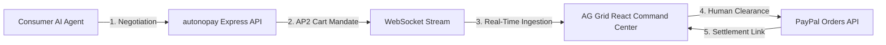

# autonopay — Autonomous Agent-to-Agent (A2A) Commerce Gateway

[](https://www.typescriptlang.org/)
[](https://reactjs.org/)
[](https://vitejs.dev/)
[](https://www.ag-grid.com/)
[](https://developer.paypal.com/)
[](https://threejs.org/)

**autonopay** is a financial command center designed for the autonomous AI economy. It solves the "trust gap" in B2B AI commerce by acting as an autonomous receiving merchant agent. When consumer AI agents (like Meta Muse or AutoGPT) negotiate for goods, compute, or tokens, autonopay validates business rules, packages the deal into an **AP2 Cart Mandate**, streams it in real-time to an AG Grid command terminal, and enables Human-in-the-Loop clearance via the **PayPal Orders REST API**.

---

## ⚡ Quick Start

### 1. Start Backend & WebSockets
```bash
cd backend
npm run dev
# Running on http://localhost:3001 and ws://localhost:3001
```

### 2. Start Frontend Command Center
```bash
cd frontend
npm run dev
# Running on http://localhost:5173
```

---

## 📖 Complete Documentation

For the complete architectural breakdown, sequence diagrams, API reference, component hierarchy, and PayPal integration guide, see:

👉 **[PROJECT_DOCUMENTATION.md](file:///r:/AI-TOOLS/Autonopay/PROJECT_DOCUMENTATION.md)**

---

## 🏗️ System Overview


